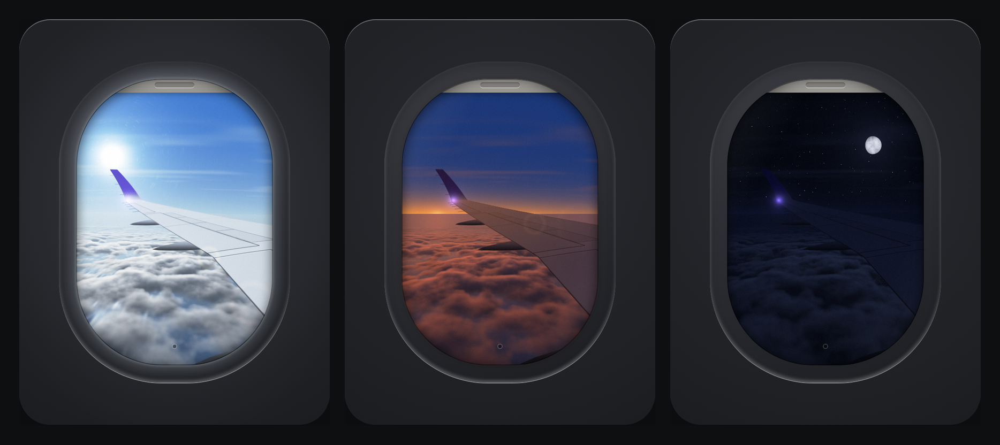

# Seat 23A

The view from the window seat, live.

One of my favorite moments on a flight is looking out of the window at the wing above the clouds. It is the moment the trip starts to feel real.

I'm working on a new onboarding for [Teara](https://teara.io), my travel app, and I wanted the first screen to do more than explain what the app does. I wanted it to bring back exactly that feeling. 23A is that screen, on its own page.

## What you are looking at

The view from a window seat just behind the wing, rendered live in the browser. The sky follows the real position of the sun for where you are, so it is day when your day is and the light turns orange when your own sun goes down. At night you get stars, city lights through the gaps in the cloud, the moon in its actual phase and the odd flash of distant lightning.

Nothing in it is a photo or a video. The clouds are a volume the camera flies over, the wing is lit by the same sun as the sky, and every so often the plane passes through a bank of cloud. Swipe down on the window to close the blind.

My favorite part is in the app: when you choose a home airport, the sun in the window moves to match your place in the world, so the view feels like your flight.

## How it works

- **Sky and clouds.** One fragment shader. The clouds are a raymarched slab with self-shadowing, and the sky colours are keyed to the sun's elevation.
- **Day and night.** The sun's position is computed from your clock and a location estimated from your time zone. "Use precise" asks the browser for your actual location. The moon's phase is computed from the date.
- **Wing.** A 737-style wing with real proportions (sweep, trailing-edge kink, dihedral, an airfoil section and a blended winglet), lit in the shader. It is also here as a 3D model: `wing.blend` and `wing.glb`.
- **Blind.** A spring that keeps the speed of your swipe.

The controls under the window let you scrub the time of day, play a full 24 hours, change the cloud cover and fly through a cloud on demand.

## Credit

Created by [Guy Magen](https://www.guymagen.com). Built with Claude.

## License

MIT. See `LICENSE`.
